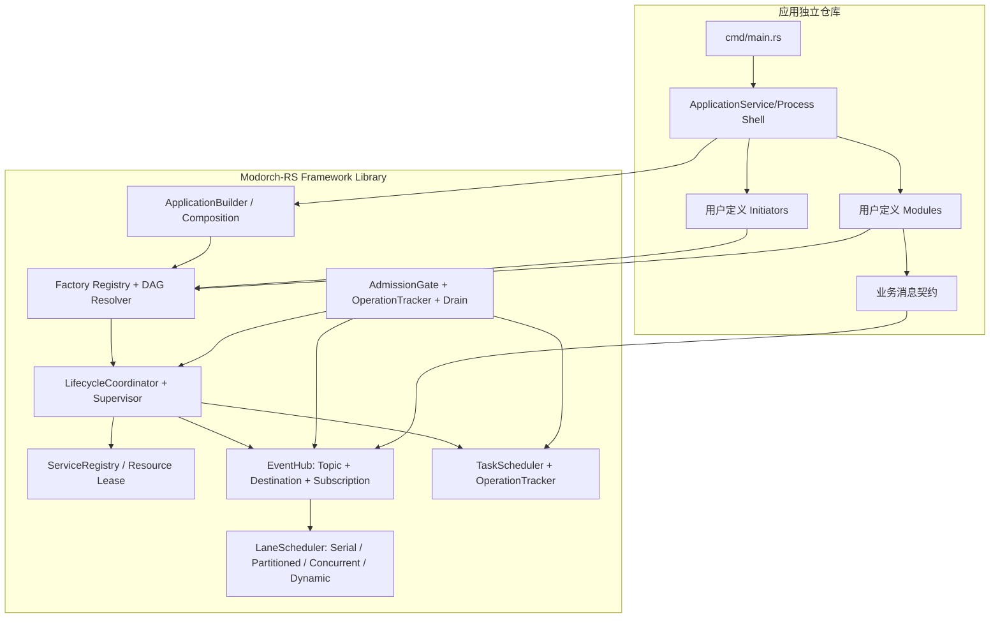
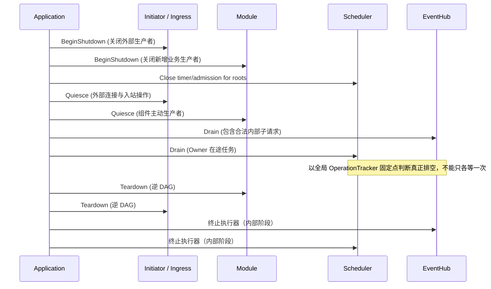

# Modorch-RS — 通用 Rust 模块化应用框架库完整设计说明书

> **项目名称：** Modorch-RS（Modular Orchestration Framework for Rust）  
> **Cargo 主包：** `modorch`  
> **文档类型：** 独立、完整的框架技术设计规范  
> **适用范围：** 单进程、常驻型和任务驱动型 Rust 后端应用  
> **规范状态：** 0.0.3 当前实现说明（2026-11-06 刷新，含 Module 入口增强；历史基线 `37bdc93`）；公开签名以源码/Rustdoc 为准，行为承诺由 Contracts 与执行证据共同确认

## 1. 框架定位、目标与边界

### 1.1 框架定位

Modorch-RS 是以 **Framework as a Library** 为产品形态的通用 Rust 模块化应用框架。它不包含业务逻辑，也不提供固定的 HTTP、数据库、设备协议或 AI 能力实现。独立应用通过 Cargo 引入框架，自主定义和集成扩展组件，声明需要启动的组件集合，由框架统一处理组件注册、依赖、实例化、共享状态、消息循环、后台任务和生命周期。

**框架仅定义两类顶层组件：**

- **Initiator**：负责创建、持有并向需要的组件提供受控共享资源与服务实例；可选地使用 EventHub 进行通知或消息处理。
- **Module**：负责业务行为、事件处理及应用任务；允许维护私有状态，但其他 Module 默认只能通过消息契约与它协作，不能直接获取其内部完整实例。

两者的差别不是简单的“有状态／无状态”，而是 **共享资源的提供与受控获取** 和 **封装业务状态的消息协作** 这两种主要使用方式。两类组件都由同一 Application 实例统一管理，都可以使用 EventHub 和 TaskScheduler。

### 1.2 设计目标

1. **独立复用：** 框架作为可发布的 Cargo 库，由多个独立应用项目按版本引入，内部不依赖任何业务应用。
2. **应用自主编排：** 应用定义可用组件和配置，选择本次启用的 Initiator、Module；未启用组件既不实例化，也不参与订阅和任务调度。
3. **统一生命周期：** 从初始化、就绪、运行到 Quiesce、Drain、Teardown，状态清晰、资源有归属且退出可验证。
4. **统一消息通信：** 支持 Event、Command、Request、Topic/Destination 路由、动态订阅和 Lane 顺序调度。
5. **资源与状态隔离：** Initiator 通过 ServiceRegistry 发布受控服务；Module 通过 EventHub 发布业务能力，各 Application 默认互相隔离。
6. **可控并发：** 支持 Serial、Partitioned、Concurrent 执行策略，队列和任务数有界，具备背压与死锁预防。
7. **宿主友好：** 不强占应用的 `main`、Tokio Runtime、信号、全局日志 Subscriber 或业务配置格式。
8. **可测试、可诊断：** 构建期验证依赖和配置，运行期跟踪处理结果、任务状态、健康和停机进度。

### 1.3 不变量

| 不变量 | 要求 |
|---|---|
| `Registered ≠ Enabled ≠ Instantiated ≠ Running` | 注册、选择、实例化与运行必须是独立状态 |
| `Accepted ≠ Completed` | 消息进入队列不代表业务已执行完成 |
| `Timeout ≠ NotExecuted` | 已执行请求的超时不能宣称无副作用 |
| `Lane ≠ Destination` | Lane 在串行策略下控制局部执行顺序，不决定消息路由 |
| `ShutdownTimeout ≠ Stopped` | 未排空工作不能虚报资源已安全释放 |
| `Arc<T> ≠ ResourceReady` | Rust 引用计数安全不等于外部资源仍可用 |
| `ComponentKind ∈ {Initiator, Module}` | 业务子分类不能扩展为额外的框架顶层组件类型 |

### 1.4 范围与非目标

框架核心只承诺**同一 Application 内进程内通信**，不内置消息持久化、进程间分布式通信、exactly-once、跨资源事务或未经协作就能安全取消任意外部副作用的能力。运行时动态库热装载与插件跨进程热升级不属于基础 API。应用可使用任意业务项目布局，只需遵循接口契约即可。

### 1.5 项目与包命名

| 用途 | 名称 |
|---|---|
| 项目 | **Modorch-RS** |
| 建议仓库名 | `modorch-rs` |
| 对外 Facade Cargo 包 | `modorch` |
| 典型 Rust 导入 | `use modorch::prelude::*;` |
| 内部包命名 | `modorch-core`、`modorch-registry`、`modorch-eventhub`、`modorch-scheduler`、`modorch-runtime` |

具体 Git 仓库和 Registry 包名须在正式发布时确认可用性。

## 2. 统一总体架构



职责分工：

| 层 | 负责 | 禁止/不负责 |
|---|---|---|
| Framework | 组件注册、依赖、生命周期、Resource Registry、EventHub、调度、停机、监督 | 引入应用业务依赖，隐式提供全局状态 |
| Application Service | 配置、功能开关、组件组合、进程信号、对外暴露时机 | 再造一套全局消息/组件管理器 |
| Initiator | 启动并持有跨组件共享资源、发布窄接口、资源关闭 | 长期暴露未受控裸可变状态 |
| Module | 业务执行、事件订阅、私有状态、后台任务 | 直接控制其他组件生命周期；绕开框架消息总线访问其他 Module 内部对象 |
| Contract Crate | Topic、命令/事件 DTO、版本、返回类型 | 拥有业务资源或管理进程 |

## 3. 工作区与独立应用布局

### 3.1 框架仓库

```text
modorch-rs/
├── Cargo.toml
├── crates/
│   ├── modorch/               # Facade，统一开发期 API
│   ├── modorch-core/          # ID、Descriptor、Error、OperationTracker
│   ├── modorch-registry/      # Factory 注册、组合、DAG、资源注册表
│   ├── modorch-eventhub/      # 消息、订阅、路由、请求状态、执行策略与 Lane
│   ├── modorch-scheduler/     # Owner 任务、Timer、TaskHandle、有界执行池
│   ├── modorch-runtime/       # Application、LifecycleCoordinator、Shutdown
│   ├── modorch-config/        # 可选：配置 schema 和 TOML 适配
│   └── modorch-observe/       # 可选：Health、Metrics、Tracing 适配
├── examples/
│   ├── minimal-app/
│   ├── stateful-initiator/
│   ├── multi-module/
│   ├── graceful-http/
│   ├── runtime-load/
│   └── mixed-load/
├── tests/
│   └── fixtures/external-app/
└── docs/
    ├── architecture.md
    ├── public-api.md
    ├── message-semantics.md
    ├── lifecycle.md
    ├── integration-guide.md
    └── compatibility.md
```

核心实现依赖（完整 Feature 图见架构说明）：

```text
modorch (facade)
  ├─ modorch-core
  └─ modorch-runtime
       ├─ modorch-registry ──────► modorch-core
       ├─ modorch-eventhub ──────► modorch-core
       └─ modorch-scheduler ─────► modorch-core
```

需要避免依赖环。`modorch-core` 不应 import `modorch-runtime`；`modorch-eventhub` 不应依赖具体应用模块；`modorch-registry` 和 `modorch-runtime` 之间资源与 Context 的类型可用低层接口 crate 或 core 中的窄 Trait 打破逆向依赖，最终编译图必须无环。

当前保留八个框架 crate，业务通过 Facade 消费；依赖图由 Cargo 检查，不合并为假定的五个发布单元。

### 3.2 独立业务应用仓库

```text
my-app/
├── Cargo.toml
├── src/main.rs                     # 极简入口
├── crates/
│   ├── app-service/                # 配置、模块编排、进程信号
│   ├── initiator-http/             # 自定义 Initiator
│   ├── initiator-shared-config/    # 自定义 Initiator
│   ├── module-storage/             # 自定义 Module，内部可有私有状态
│   ├── module-order/               # 自定义 Module
│   ├── module-worker/              # 自定义 Module
│   └── order-contract/             # Order 能力 owner 定义的 typed DTO
└── config/application.toml
```

业务模块可作为外部依赖；框架绝不要求模块必须位于自身 Workspace。

### 3.3 Cargo / 版本策略

根工作区使用 resolver 3、Edition 2024、版本 0.0.3、MIT、MSRV 1.85。当前尚无正式 Registry 发布声明。实际依赖与 Feature 定义见 [Facade manifest](../crates/modorch/Cargo.toml) 与 [兼容性说明](compatibility.md)。

默认开启 runtime/eventhub/scheduler；runtime 同时启用 eventhub 与 scheduler，core/registry 不可选，config-toml 与 observability 可选。没有库级 signals Feature；信号由宿主 Tokio 提供。Feature 是编译时加法，运行时选择由 ComponentSelection 完成。

## 4. 唯一顶层分类：Initiator 和 Module

### 4.1 精确定义

| 维度 | Initiator | Module |
|---|---|---|
| 主要交互 | 通过 Registry 提供受控共享服务/状态 | 通过 EventHub 接受消息、执行行为 |
| 状态拥有权 | 可以拥有共享/进程资源 | 可以拥有私有业务状态 |
| 是否存在状态 | 不强制，但通常有 | 不强制，可以有 |
| 能否使用 EventHub | 可以，非主要职责 | 可以，默认主要职责 |
| 是否提供可访问实例 | 仅经注册的窄能力/ServiceHandle | 默认不暴露 Module 对象 |
| 后台 Task | 可选 | 可选 |
| 生命周期 | 框架统一管理 | 框架统一管理 |
| 启动顺序 | Initiator 阶段优先、组内 DAG | Initiator 后按 DAG |
| 停机顺序 | Module 释放后释放 | 优先停止接入并排空，逆 DAG 释放 |

不能以“内部有 `Mutex` 或 `HashMap`”判定为 Initiator。`UsageModule` 即使持有 DuckDB、缓存、连接池，如果它通过消息契约提供操作且不对外借出资源，可仍定义为 Module。若多个模块确需共享底层连接池，并允许按窄接口直接使用，则采用 Initiator 提供共享 ServiceHandle。

### 4.2 公共 Trait

真实定义见 [component.rs](../crates/modorch-runtime/src/component.rs)：Lifecycle 的 setup/start/ready/begin_shutdown/quiesce/teardown 使用 async-trait，支持对象安全的 Box<dyn Initiator/Module>。钩子默认返回成功；start 必须及时返回，长任务交给受管 Scheduler。

Module::handlers 与 Initiator::event_endpoint 都返回可选的单套 HandlerRegistration，可包含多个订阅。Initiator::activate_ingress 与 Module::activate_ingress 在全体相关 ready 之后经 Instance 统一分发，全部成功才报告 Ready；setup 可 bind 未 listen 的 socket，实际 listen 留到激活。监督重建激活错误纳入单次尝试、补偿及累计预算；任务/服务能力受代际约束，应用级 Hub 不随代际失效。不得把旧草案的 Vec<HandlerRegistration> 当作现有 API。

### 4.3 ComponentDescriptor

[组件元数据源码](../crates/modorch-core/src/lib.rs)

`requires` 只允许 `Initiator → Initiator`、`Module → Initiator`、`Module → Module`，默认不允许 Initiator 依赖业务 Module，以保证确定的组级生命周期；跨层反向依赖需重构为 Service/Port，而不是绕过生命周期。

Module 的 `execution` 有效；Initiator 只有在显式声明 EventEndpoint 时才需要执行策略。非法或无效容量应在 Build 阶段拒绝。

### 4.4 两种 Factory / Registry

[Factory 与配置验证源码](../crates/modorch-runtime/src/component.rs)

应用注册 Factory，而不是注册已启动的对象。重复 ComponentRef 拒绝；Factory 不应在注册阶段做网络连接、建表、绑定端口等有副作用操作。Factory 的真实资源初始化应放到 `setup`。

## 5. ApplicationBuilder：按需编排与激活

### 5.1 五个阶段

```text
Register Factory
   ↓
Select Enabled Components
   ↓
Resolve Dependencies / Validate
   ↓
Instantiate Only Enabled Components
   ↓
Setup / Start / Ready / Accept Requests
```

- **Register**：让框架知道“有哪些能力可供选择”。
- **Select**：应用决定“本次启动需要哪些能力”；默认不偷偷启用所有注册的组件。
- **Resolve**：检查 `requires` 依赖存在、已选择、无环、没有不合法的跨层依赖。
- **Instantiate**：只为选中组件创建实例；未启用组件不占用线程、socket、连接池等。
- **Start**：执行生命周期与 readiness；成功后才开放外部准入。

默认缺失依赖报告 MissingDependency，已注册但未启用报告 DisabledDependency；提供显式 `.resolve_dependencies(DependencyResolution::IncludeRequired)` 策略，但不能隐式加载非用户选择的模块。

### 5.2 Composition 配置

```toml
[application]
name = "order-service"

[initiators.route_registry]
enabled = true

[initiators.shared_config]
enabled = true

[modules.storage]
enabled = true

[modules.order]
enabled = true

[modules.worker]
enabled = false

[messaging]
default_queue_capacity = 1024
per_shard_capacity = 64

[shutdown]
grace_period_secs = 30
```

Framework 提供可选 TOML schema/转换工具，但进程配置文件路径、环境变量合并优先级及业务配置由应用负责。配置解析错误必须在创建有副作用资源之前报告。

### 5.3 Application 所有权

`ApplicationBuilder::build()` 返回未启动 Application；`Application::start().await` 返回可克隆的 `ApplicationHandle`。启动失败须保留可检查的清理结果；尚有在途资源时不可把部分初始化失败当成完全释放。

- `Application` 是单次启动生命周期所有者；要重启须创建新实例（一期不要求同一实例复活）。
- `ApplicationHandle` 暴露 `wait()`、`health()`、`begin_shutdown()`、`shutdown_checked()`、`event_hub()` 的受控句柄。
- 默认复用当前 Tokio Runtime，不创建私有 Runtime；不调用 `std::process::exit()`。
- SIGINT/SIGTERM、日志 Subscriber、进程 CLI、是否支持多 Runtime，均由宿主应用控制。

## 6. Initiator 状态与服务注册表

### 6.1 ServiceRegistry 规则

- 资源由明确的 Initiator Owner 创建、注册、关闭；Framework 持有 Registry 的实例作用域。
- 通过 `ServiceKey(name, type)` + 类型化 `ServiceHandle<T>` 暴露受控服务接口。
- 读侧必须声明依赖并只获取获准的服务；不允许匿名访问任意可变对象。
- 资源可用性必须受 Owner State 和 ServiceLease 约束：持有 `Arc<T>` 只保证内存有效，不保证数据库连接等逻辑资源尚未关闭。
- Owner 在所有借用者模块和相关任务 Drain 完成后才能 teardown；未完成时保留资源且返回不完整关闭回执。
- `ServiceHandle<T>::acquire()` 返回受 Owner 状态保护、会被 OperationTracker 计数的 `ServiceLease<T>`；租约有效期间可使用线程安全服务接口，Owner 必须在所有租约释放后才能拆卸底层资源。
- 不应仅把裸 `Arc<T>` 当作受控服务句柄；若必须暴露由用户定义的内部可复制句柄，业务组件需要保证该句柄的每次外部操作执行独立的可用性检查。关闭后新获取/使用失效服务返回 `ServiceUnavailable`。
- 不提供跨 Application 的全局单例 Registry；如需共享基础资源必须由外部宿主显式注入，并声明所有权 Borrowed/Owned。

### 6.2 何时选择哪一类

| 场景 | 分类 | 理由 |
|---|---|---|
| HTTP RouteRegistry / Listener | 窄共享路由服务用 Initiator；私有入口用 Module | 两者统一 activate_ingress；受管任务与检查式关闭 |
| 通用共享配置快照查询接口 | Initiator | 其他组件需要受控共享读取 |
| 配置热更新、激活命令及通知 | Module | 可由 Module 私有持有配置并通过消息交互 |
| 用量存储（私有 DuckDB owner） | Module | 其他组件只通过 typed Command/Request 操作 |
| 数据库共享连接池 | Initiator | 多组件明确借用同一底层资源 |
| 订单服务（内部缓存、业务状态） | Module | 业务状态不直接开放实例 |
| 周期清理作业 | Module | 任务和事件是主要职责 |

以上是建议分类而非硬编码限制。

## 7. EventHub：统一消息模型

### 7.1 消息信封

[消息信封源码](../crates/modorch-eventhub/src/types.rs)

- `topic` 表示事件/命令语义与版本，例如 `storage/save/v1`。
- `destination` 决定谁接收；Request 和 Command 必须精确解析到一个已启用目标，Event 允许广播到多个订阅者。
- `lane_key` 仅影响局部串行域，不改变接收目标；Serial 为组件域，Partitioned 为 shard，Dynamic 为活跃 Key，Concurrent 不承诺顺序。
- `source` 和调用链信息由框架生成/校验，不允许非可信业务输入伪造内部执行身份。
- `payload` 首先支持进程内类型化 `Arc<dyn Any + Send + Sync>` 或等价类型擦除；Serde/JSON/CBOR 是可选 Transport Adapter。禁止把 `oneshot::Sender` 混入需要持久化的业务 Payload。

### 7.2 三类调用、准确回执

| API | 投递与结果 | 队列满 | 超时后结果 |
|---|---|---|---|
| `publish(event)` | 对匹配订阅者独立 Fanout，返回投递统计/拒绝报告 | Drop/Reject/Wait 均要显式策略 | 不保证 Handler 完成；非持久 |
| `command(target,cmd)` | 返回 `AdmissionReceipt`，**只表示受控队列接受** | 返回 `Backpressure` | 未返回业务完成不代表未执行 |
| `request(target,req)` | 返回 `RequestHandle`；等待唯一 Handler 的 typed 完成 | 返回 `Backpressure` / AdmissionTimeout | 如已开始执行则 `Indeterminate(OperationId)` |

对于 Event，订阅者 A 已成功入队、B 失败入队时返回 PublishReport 中每接收方的状态（is_partial 可查询部分成功）；不能把一次广播的部分失败说成全部成功。默认策略应为 **Reject with explicit error**（不是静默丢弃），确实允许丢弃的 Telemetry Event 才显式选择 `DropNewest` 等策略。

### 7.3 订阅与路由

[订阅类型源码](../crates/modorch-eventhub/src/types.rs)

- `SubscriptionId` 是唯一订阅身份，不能与业务 destination matcher 混用。
- `topic_pattern` 采用 MQTT Topic Filter：`+` 独占单层（含空层），`#` 独占末层并含零层；`:id` 是字面量。根通配不匹配 `$`，保留 `/` 空层；单向匹配已校验的 Topic Name。Name/Filter 均非空、无 NUL、最多 65535 UTF-8 字节，Name 禁止 `+/#`。超本地预算返回 ResourceLimit，协议非法返回 InvalidConfig；细则见[消息语义](message-semantics.md)。
- 路由按 `topic + destination` 双维度筛选；`lane_key` 不参与订阅匹配。
- 启动订阅必须在模块 Ready 前完成；运行时订阅变更通过独立控制面串行提交。
- `subscribe/unsubscribe` 返回**已生效回执**，拒绝操作不能稍后偷偷执行；取消订阅不等价于已有 Handler 已排空。
- 当前不使用匹配结果缓存；Filter 在订阅安装时编译，helper 和索引复用同一 matcher，`:id` 进入精确索引。索引、订阅变更和入队共享线性化边界；回执含订阅 generation。
- 启用和停机阶段不可产生向已禁用模块的“幽灵路由”。

### 7.4 四种执行策略与 Rust 所有权

[执行策略源码](../crates/modorch-core/src/lib.rs)

- **Serial**：整个 Module 一个 `SerialHandler: Send`，使用 `&mut self` 顺序执行。
- **Partitioned**：固定 `N` 个 shard mailbox，每个 shard 一个独立 `SerialHandler`；按稳定 hash(`lane_key`) 映射；同 Key 依准入序 FIFO，不同 Key 如果碰撞同 shard 也可能串行。不同 shard 可并行。
- **Dynamic**：每个活跃 Key 一套 SerialHandler 与有界邮箱，受 max_lanes 和 idle_timeout 限制；空闲回收后不保留 Handler 私有状态。
- **Concurrent**：共享 `Arc<dyn ConcurrentHandler + Send + Sync>`，固定 Worker 与 Dispatcher 限制并发；不承诺 Handler 执行顺序。

Handler 的对象所有权需在接口层显式区分：

[Handler 所有权与注册源码](../crates/modorch-eventhub/src/workers.rs)

HandlerFactory 在模块完成 Setup 后创建 Worker 实例，`&mut self` 不会被多个任务并发借用。Dynamic 已实现最大 Lane 数（含构造中预留）、空闲回收和停机回收；工厂在路由锁外调用，超时不能中断同步工厂。跨 shard 共享状态必须通过明确的线程安全服务或消息聚合处理，不能默认为分片副本数据一致。

**顺序保证的精确定义**：Serial、Partitioned、Dynamic 中同一串行域在同一代际按成功准入顺序执行；Concurrent 不承诺顺序；多生产者并发时以路由器成功准入线性化顺序为准。不承诺独立模块间全序、Event Fanout 原子性或跨进程顺序。

### 7.5 防止同步等待死锁

- HandlerContext 与 OperationTracker 传播框架生成的因果身份；WaitGraph 使用组件/shard/Lane 等待域，Concurrent 使用保守组件域。
- 请求入队前向 WaitGraph 登记“当前同步等待目标”的边。检测自己等待自己、`A→B→A`、`A→B→C→A` 并返回 `CircularWait`。
- 默认**拒绝受限 Lane 的同步重入**，不复制 Go 中可重入共享 Handler 行为；避免 `&mut self` 的排他语义被破坏。
- 串行 Lane 内的业务可以改用 `publish` 或独立子任务实现非阻塞链，或将相关操作设计为异步状态机。
- Handler 不得无限等待一个只有自己所在 shard 能继续处理的工作。
- WaitGraph 边在等待完成、失败或取消后必须准确删除；不能由业务随意伪造父链。

### 7.6 Request 取消状态机

```text
Created → Admitted → Queued → Running → Completed
          │          │          └→ CompletedAfterCallerTimeout
          │          ├→ CanceledBeforeStart
          └→ Rejected / AdmissionTimedOut
```

`CallerTimedOut` 是**等待者状态**，不是任务执行状态。排队前的取消不能被执行；已执行的协作式取消需 Handler 配合，结果可能仍有外部副作用。`RequestHandle` 提供 `operation_id`，允许上层选择查询完成状态或去重，但默认不自动重试有副作用请求。路由器不得在请求取消时直接伪报“未执行”。

## 8. TaskScheduler：任务所有权与定时器

API 目标：

[TaskScheduler 源码](../crates/modorch-scheduler/src/lib.rs)

- `TaskScheduler` 是从 ComponentContext 获取的 **owner-bound 句柄**，Owner ID 由框架绑定，业务调用方不能自行伪造；所有后台任务都必须归属于一个已启动组件。不得绕开监督通过 `tokio::spawn` 永久遗留任务。
- Task Handle 具备 Accepted/Running/Completed/Failed/CancelRequested/Cancelled 等状态与完成结果。
- Scheduler 入口关闭后拒绝外部新任务，允许在途工作产生满足规则的受控子任务。
- 周期 TimerDriver 与真正执行业务的 Worker Pool 分离；定时器占用数量、队列长度、并发执行数均有上限。
- 默认定时任务 **SkipIfRunning**，避免运行慢时无界重叠；允许显式 QueueBounded/AllowOverlap。
- OperationTracker 记录 Owner 的在途任务，支撑 Shutdown 排空；调用 `CancellationToken.cancel()` 只是发出协作式取消信号，并非任务已经完成。
- OperationTracker 将准入与租约登记线性化；不以第三方 TaskTracker 的 close 代替该屏障。
- spawn 接受取消 Token 闭包，delay/interval 接受 TaskFactory。spawn_cpu/spawn_blocking_io 进入各自有界池；wait_finished 确认自身额度与捕获已释放，wait 只表示结果可读。

## 9. 生命周期与应用启动

### 9.1 Application 状态

```text
New → Initializing → Starting → Ready / Degraded / Recovering
                        ↓            ↓            ↓
                      Failed ───────────────→ Quiescing
                                                  ↓
                                              Draining
                                                  ↓
                                              Stopping
                                                  ↓
                                             Stopped
```

因排空超时进入 `StopIncomplete`（附当前阶段与未完成工作）；允许调用 `shutdown_checked` 重试，但**不能重复释放已成功拆卸的资源**。`Stopped` 是不可逆状态，重复关闭幂等。Stopped 后只能创建全新 Application；运行期 Restart 可在旧闭包排空和拆卸后推进组件代际。

### 9.2 启动阶段（必须有启动事务日志）

1. Builder 完成注册、配置、Feature 裁剪与启用选择。
2. 对全体选中组件做 ComponentRef 唯一性、依赖存在性、类型、DAG、队列容量检查。
3. 初始化内部 EventHub、TaskScheduler、ServiceRegistry，**默认 External Admission Closed**。
4. 按 Initiator 的拓扑次序 Factory Create + Setup；成功后调用 `export_services`，通过受控 ServicePublisher 注册共享能力，并记录资源归属。
5. 检查外部/内部所需基础服务是否就绪。
6. 按 Module 的拓扑次序 Factory Create + Setup，构造 HandlerFactory、安装 Mailbox 和订阅。
7. 按 Initiator 的拓扑次序调用 Start，随后按 Module DAG 顺序调用 Start。两者均应快速返回；长任务交给 Scheduler。
8. 框架等待各组件 Ready/Handler 注册确认，随后执行必要的 `activate_ingress`（例如 HTTP Module 启动实际监听），最后对外报告 Ready。
9. Supervisor 开始正常运行；任何核心启动失败触发有检查回执的部分启动回滚。

`Start` 阶段不能依赖尚未 Ready 的目标进行同步请求；需要 Bootstrap 请求须显式声明可用的 Ready 条件或拆成独立的 Bootstrapping 机制。

### 9.3 组级与 DAG 约束

- **Initiator** 全组 Setup 优先于 **Module** Setup，Module Teardown 优先于 Initiator Teardown。
- 同组按显式 DAG 拓扑顺序启动，逆拓扑关闭；依赖决定顺序，不能仅靠 Weight。
- 同一 DAG 层的 Setup 是否并行是一项可选优化；基础实现应先采用确定性的顺序执行以简化错误回滚和资源约束。
- 内部消息通信依赖不等于资源生命周期依赖；涉及必需资源时必须写入强依赖。

## 10. 停机协议（生产级强制要求）

### 10.1 阶段划分



**精确准入规则**：Root 入站在 BeginShutdown 后一律拒绝；已经被接受且正在执行的 Operation 可以在已有因果链下提交必要的 Internal Child Operation。准入、计数和 OperationLease 创建必须具备一个线性化边界，防止“确认排空后又成功进入子操作”。孤立新生产者不可借内部接口绕过停机。

### 10.2 OperationTracker

- 跟踪 Root Operation、Child Operation、Message Dispatch、Handler、Owner Task、Timer Dispatcher 等依赖业务资源的在途工作。
- `Lease` 由框架创建，跨 await 持有直到真实工作完成；业务 Future 超时/取消不能私自把已启动的工作从 Tracker 中抹掉。
- 排空需先证明外部生产者停止，随后等待全局在途计数归零，并再次验证准入没有新工作可进入。
- `Drain` 超时返回 `StopIncomplete { phase, pending: PendingWork, errors }`，保留依赖资源及所需执行器可用，并允许后续重试。
- 无法协作退出时可提供 `force_shutdown()` 独立接口，明确这是**可能损失在途操作**的操作，不返回 `GracefullyStopped`。
- 如果进程直接被 OS 强制结束，框架无法保证完成排空；应用负责为重要外部副作用使用幂等键/持久化恢复机制。

### 10.3 部分初始化错误

- `Setup` 可能创建部分资源后失败，必须把该组件记为 `PartiallyInitialized`，进入相同 Quiesce/Teardown 屏障。
- 失败主因、每个补偿步骤失败原因均记录；最终错误不得被次要清理异常覆盖。
- 已成功释放的资源与组件记录 checkpoint；重试时只重试未完成部分。

## 11. 故障监督与错误语义

[FailurePolicy 源码](../crates/modorch-core/src/lib.rs)

默认 FailFast。StopDependents 与 Restart 均已实现；Restart 在旧闭包排空和拆卸后按累计预算重建，不自动重放消息，预算耗尽转 FailFast。禁止直接在原资源仍被借用时启动第二代对象。

推荐结构化错误：`DuplicateComponent`、`MissingDependency`、`DependencyCycle`、`DisabledDependency`、`InvalidConfig`、`NotReady`、`Closed`、`Backpressure`、`Unroutable`、`AmbiguousDestination`、`CircularWait`、`AdmissionTimeout`、`ExecutionFailed`、`Indeterminate`、`StopIncomplete`、`ServiceUnavailable`、`ResourceLimit`、`CanceledBeforeStart`、`Cancelled`、`TypeMismatch`、`AccessDenied`、`ComponentUnavailable`。

错误应携带 `ComponentRef`、`OperationId`、`Phase`、`Retryable`（只表明技术重试可能性，不代表业务幂等）和 `source`；不把任务 panic 变成正常成功回执。

## 12. 健康、观测与安全

- Health：New/Starting/Ready/Degraded/Failed/Stopping/Stopped；依赖型 Readiness 必须在入口开放前完成；Live 与 Ready 分离。
- Metrics：Application ID、Component ID、消息类型/Topic、路由结果、队列长度、Active Lane、Shard 队列深度、InFlight、拒绝、P95/P99、Task 数、Cancel/Timeout、Drain 耗时。
- Tracing：入站根 Operation 创建 Span，子请求传播因果 Trace；不能用可伪造的用户 Payload 作为受信身份。
- 日志：框架使用 `tracing` 记录，不在库内部安装全局 subscriber；应用自行选择 JSON/文本和采样策略。
- 共享 ServiceRegistry：在 API/代码结构上限制模块请求超出依赖声明的资源，避免隐性资源耦合；这是框架级能力边界，并非针对不可信第三方插件的沙箱隔离。
- 外部协议由应用实现鉴权、限流及请求输入验证，框架只负责受控的内部通信。

## 13. 独立应用集成示例

只消费 Facade。可运行来源为 [minimal-app](../examples/minimal-app/src/main.rs)、[stateful-initiator](../examples/stateful-initiator/src/main.rs)、[multi-module](../examples/multi-module/src/main.rs)、[graceful-http](../examples/graceful-http/src/main.rs) 和 [独立工作区](../tests/fixtures/external-app)。配置、信号、全局日志与 Runtime 由宿主持有；入口使用 ExternalEventHub 建立新根，Handler 的子操作使用 ctx.event_hub。

## 14. 公共 API 表面与兼容承诺

唯一调用入口为 modorch；[Facade 源码](../crates/modorch/src/lib.rs) 定义完整导出和 prelude。Markdown 不重复维护全量签名。公开字段和错误变体在 0.0.3 开发阶段可能变化，迁移须复核结构体字面量、穷举匹配和 Feature。

StartupError.source 为 Box<FrameworkError>，标准 Error::source 暴露原始 FrameworkError；cleanup 与 ApplicationHandle 保留。ShutdownOptions.timeout 限制调用者等待而不取消关闭事务。具体边界见 [公共 API](public-api.md)、[兼容性](compatibility.md) 与本次文档验收记录。

## 15. 核心验收标准（以行为为准）

### 15.1 应用与模块装配

- [ ] 独立仓库应用通过 Cargo 依赖框架，框架没有反向引用应用源码。
- [ ] 应用创建两个独立 Application 实例，注册表、消息、状态不串扰。
- [ ] 可分别注册多个 Initiator/Module，重复 ComponentRef 被拒绝。
- [ ] 注册但禁用组件不会创建对象、连接端口或提交 Task。
- [ ] 未编译 Feature 对应模块无法被配置假启用。
- [ ] 缺失、禁用、自依赖与循环依赖在 Build/Start 前明确报错。
- [ ] Initiator 依赖 Module 被默认阻止。
- [ ] 按 DAG 正序启动、逆序释放；模块启动失败能记录部分初始化并进入安全清理。

### 15.2 状态与资源

- [ ] Module 可有私有状态，但不能通过 Registry 偷偷访问其完整实例。
- [ ] Initiator 的 ServiceHandle 支持线程安全跨组件共享。
- [ ] Owner 被依赖时，未 Drain 完成不会释放外部资源。
- [ ] 关闭后新获取/使用失效服务返回明确错误。

### 15.3 EventHub 与并发

- [ ] Topic + Destination 的路由匹配准确，LaneKey 不改变目标。
- [ ] Subscribe/Unsubscribe 的成功回执代表变更已经生效。
- [ ] Event 多订阅者投递部分失败能准确报告。
- [ ] Command 成功只表示接受入队，不被标记业务成功。
- [ ] Request 处理完成才产生完成回执；执行后等待超时为 Indeterminate。
- [ ] 串行组件 FIFO，Partitioned 同 Key FIFO，多 shard 并发。
- [ ] Concurrent 模式严格受 max_in_flight 限制。
- [ ] 有界队列满时明确拒绝，不默认无界内存占用。
- [ ] A→A、A→B→A 请求等待图循环被拒绝，不依赖超时解决。
- [ ] 订阅变更与路由准入之间没有失效路由发布；当前无路由缓存。

### 15.4 Task 与停机

- [ ] 所有 Task 有明确 Owner、状态和完成/取消回执。
- [ ] Timer 不永久占满 Worker；超时/重复 Tick 行为有明确约束。
- [ ] 关闭入口后拒绝新根操作，允许合法在途子请求完成。
- [ ] Drain 的计数覆盖 EventHub、Handler、Owner 任务 和相关内部子请求。
- [ ] Drain 超时返回 StopIncomplete，保留未完成工作和依赖资源。
- [ ] 重试 Shutdown 不重复关闭已经释放的组件。
- [ ] ForceShutdown 与 GracefulShutdown 有不同的结果类型和日志。
- [ ] 取消、Panic、队列关闭、模块退出竞态通过并发回归测试。
- [ ] Framework 不强占 Host Runtime、全局 tracing Subscriber 和进程信号。

### 15.5 建议验证命令

```bash
cargo fmt --all -- --check
cargo check --workspace --all-targets
cargo test --workspace
cargo clippy --workspace --all-targets -- -D warnings
cargo test -p modorch-eventhub --test concurrency -- --nocapture
```

额外设计 `tokio::test(start_paused = true)`、多线程高并发、Fault Injection、资源借用与停机竞态测试；对 AdmissionGate/OperationTracker 可使用 Loom 等状态空间测试。本次实际命令与输出见 docs/validation/2026-11-02/documentation-skills/；远程 CI 未由本地执行推定。

## 16. 实施计划与交付范围

| 阶段 | 目标 | 验收出口 |
|---|---|---|
| M0：库化与公共 API | Facade/Manifest/独立应用示例，统一 Initiator/Module 契约 | 外部 Workspace 可编译引入、模块按需编排 |
| M1：Factory/Composition/DAG | 注册、选择、资源/实例所有权、依赖排序、部分启动清理 | 未启用不实例化，DAG 与失败回滚测试 |
| M2：EventHub | Topic/Destination、订阅、Request/Command/Event、反压 | 回执与动态订阅竞态测试 |
| M3：Lane 与 HandlerFactory | Serial/Partitioned/Concurrent/Dynamic、WaitGraph | FIFO、并发上限、循环等待测试 |
| M4：统一停机 | AdmissionGate + OperationTracker + Owner 任务 + CheckedShutdown | 不完整排空可重试，无提前资源释放 |
| M5：生产化 | Config/Health/Tracing、示例、MSRV 和版本兼容 | 完整 CI、压测、稳定公共 API |

**实施顺序约束：** 必须先固化公共组件契约与实例级注册，再实现 EventHub 的准确回执与 Lane，最后接入统一 OperationTracker 停机。每个阶段均以通过对应的自动化验收为结束条件，不能因为存在接口草图就宣称已交付能力。


## 17. 规范级术语和接口边界

| 术语 | 定义 |
|---|---|
| Application | 框架运行和关闭的最高所有权单元；拥有一套独立组件、消息、任务和资源注册表 |
| Component | Initiator 或 Module 的统称；使用 `(ComponentKind, ComponentId)` 唯一标识 |
| Factory | 注册阶段提交的无业务副作用实例创建器；只为 Enabled 组件执行 Create |
| Composition | 应用声明的启用集合及其配置，经过 Resolve 后成为不可变启动计划 |
| Initiator | 对外提供受控共享状态/资源服务的组件类型 |
| Module | 封装业务行为和私有状态、通过事件或请求契约协作的组件类型 |
| ServiceHandle | 获取 Initiator 提供的受控服务的入口，作用域限制在单 Application |
| ServiceLease | 使用期间登记在途工作并保护服务 Owner 的资源租约 |
| EventHub | 负责 Topic/Destination 订阅匹配、路由、投递和响应关联的内部消息系统 |
| Lane | 消息处理时的局部串行域，按组件执行策略映射到组件、shard 或活跃 Key |
| AdmissionGate | 统一准入判定，控制哪些根操作和因果子操作可以进入运行时 |
| OperationTracker | 跟踪消息、Handler、子请求、任务和资源租约的实际在途状态 |
| Quiesce | 停止组件主动生产新工作并等待生产者静止，不等同于释放资源 |
| Drain | 在允许合法在途子工作的前提下等待全局受控工作归零 |
| CheckedShutdown | 带有明确完成或未完成回执的关闭过程 |

### 17.1 框架与应用的强制边界

- 应用决定**定义什么、注册什么、启用什么**；框架决定**如何调度、通信、监督和安全退出**。
- 每个 Application 各自创建自己的 Factory 表、EventHub、SchedulerRuntime、ServiceRegistry 和 Shutdown 状态，不以隐式全局单例共享。
- 两类组件可以使用同一消息总线；但默认不允许其他组件直接获取 Module 对象，也不允许 Initiator 把未受控可变指针作为公共资源。
- 未启用组件不得创建业务资源、订阅消息或运行后台任务；强制依赖缺失必须在运行前报告。
- 已入队工作和已完成工作必须可区分；在途工作结束前不得销毁其依赖的状态或连接。
- 框架提供的是进程内运行与所有权协议，不替代业务层认证授权、幂等、事务和数据恢复设计。

### 17.2 文档验收定义

本文件按 **Modorch-RS 0.0.3 当前实现** 刷新；验收清单的执行证据由独立验证报告记录。框架实现只有在公共 API、依赖图验证、消息正确性、并发边界、资源生命周期、停机可靠性以及跨仓库集成测试全部满足本文验收要求后，才可宣称符合本设计。
