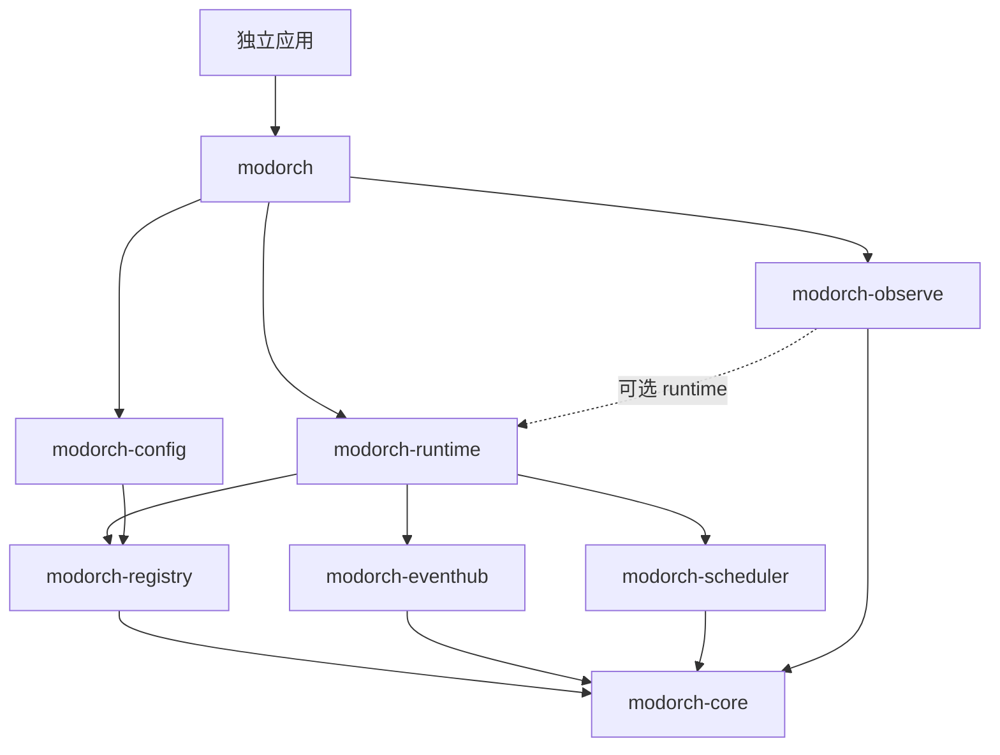

# 实现架构

框架采用八个单向依赖的库 crate；应用示例只消费 Facade：

- core：组件身份、描述符、结构化错误、OperationTracker、故障通道和操作 Span。
- registry：启用配置、DAG、依赖及容量验证、Owner 服务发布、受控读取和租约。
- eventhub：类型擦除 DTO、订阅控制面、路由、准确回执、固定分片、并发限制、等待图。
- scheduler：Owner 任务、状态及完成回执、协作取消、独立 TimerDriver、有界任务与 Tick 策略。
- runtime：Factory、Context、生命周期事务日志、Ready 屏障、监督、检查式关闭和重试 checkpoint。
- config：可选 TOML schema；路径、环境合并及业务配置校验由宿主负责。
- observe：快照转换；Exporter、日志 Subscriber 和采样由宿主提供。

Registry、Hub、Scheduler、Tracker、FailureReporter 和关闭状态均在 Application Build 时创建，不存在隐式全局单例。动态订阅与路由共享短时互斥控制面，匹配和有界队列准入在线性化边界内完成；当前不使用路由缓存，因此没有过期缓存回填路径。

Handler 与 Lifecycle 对象分离：SerialHandler 拥有独立可变状态，Partitioned 的 HandlerFactory 为每个固定 shard 构造实例；ConcurrentHandler 共享 Arc，固定 Worker 复用维持严格的在途上限。CPU 与同步阻塞 I/O 通过 Owner 绑定的 Scheduler 接口进入独立有界执行池，异步任务继续使用宿主 Tokio。一个组件拥有一套执行策略和邮箱，可以有多个订阅。

监督器保存 Build 阶段冻结的描述符和无资源副作用 Factory。按组件恢复与完整关闭共用生命周期事务锁，OperationTracker 为受影响闭包提供独立准入门、排空和代际。服务与任务的能力句柄携带代际，旧代际事件从故障邮箱中消费后忽略。

Dynamic 执行策略在受限 Lane 表中惰性创建 SerialHandler，Worker 在空闲后于路由控制面中确认邮箱为空并回收。等待式入队监听容量变更后重新路由和准入，不保存跨订阅代际的旧 Sender。Loom 单元测试将真实 OperationTracker 的状态互斥锁替换为可模型检查的互斥锁，检查根准入/关闭及代际推进竞态。
